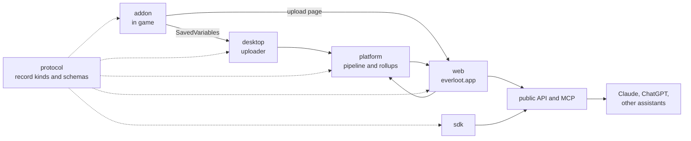

  <picture>
    <source media="(prefers-color-scheme: dark)" srcset="https://raw.githubusercontent.com/Everloot/.github/main/assets/everloot-logo-dark.png">
    
  </picture>

<b>The WoW: Forever database, built from player data.</b> 
An addon that records what players see, a site that publishes it, and AI connectors that answer with it.

  <a href="https://everloot.app">everloot.app</a> ·
  <a href="https://discord.gg/9CKsbHTRu3">Discord</a> ·
  <a href="https://everloot.app/connect">Use it from Claude or ChatGPT</a> ·
  <a href="https://everloot.app/methodology">How we count</a>

## How it fits together

## Repositories

| Repository | What it is | Status |
|---|---|---|
| [everloot](https://github.com/Everloot/everloot) | Today's home of everything: addon, site, knowledge base, desktop companion. Becomes `addon` after launch | public, active |
| [protocol](https://github.com/Everloot/protocol) | Upload record kinds and limits, API response shapes, MCP tool schemas | public, moving here after launch |
| [sdk](https://github.com/Everloot/sdk) | TypeScript client, SavedVariables parser, local MCP server | public, moving here after launch |
| [desktop](https://github.com/Everloot/desktop) | Desktop companion: uploader, `/ask` bridge, price writer | public, moving here after launch |
| web | everloot.app | private |
| platform | Data pipeline, rollups, anti-spam, quotas | private |
| ios | The iOS app | private, planned |

WoW: Forever launches on November 4, 2026. Until then the code stays in
[Everloot/everloot](https://github.com/Everloot/everloot); each part moves to its own repository after
launch, with its history.

## Help out

Play with the addon and upload, report wrong data, or pick a
[good first issue](https://github.com/Everloot/everloot/labels/good%20first%20issue). Bugs posted in the
Discord `#bug-reports` forum are welcome too.

---

Everloot is a fan project by R21 Media Group, LLC. It is not affiliated with or endorsed by
Blizzard Entertainment. World of Warcraft is a trademark of Blizzard Entertainment, Inc.
